# LocaleDesk 官网与域名配置学习笔记

> 整理自 Cursor 对话（agent `aee732d0-71b4-4c0c-b81d-ca9f1b9888df`）  
> 起点：*「Using brainstorming 先定网站方向…适合做 Workers 静态站点落地页」*  
> 时间跨度：约 2026-10-12 ～ 2026-10-22  
> 截图目录：[`images/`](./images/)（共 21 张，原样保存）

本文按学习路径编排：**定方向 → 定品牌/域名 → Spaceship 接到 Cloudflare（重点）→ Worker 绑自定义域 → SEO / GSC**。完整设计说明另见：

- `docs/superpowers/specs/2026-10-12-marketing-website-design.md`
- `docs/superpowers/plans/2026-10-12-marketing-website.md`
- `docs/superpowers/specs/2026-10-22-localedesk-technical-seo-design.md`

---

## 目录

1. [网站方向（Brainstorming 决策）](#1-网站方向brainstorming-决策)
2. [命名与域名选型讨论](#2-命名与域名选型讨论)
3. [Spaceship → Cloudflare 域名接入（逐步截图）](#3-spaceship--cloudflare-域名接入逐步截图)
4. [Worker 自定义域绑定](#4-worker-自定义域绑定)
5. [技术 SEO 与 Google Search Console](#5-技术-seo-与-google-search-console)
6. [速查表](#6-速查表)
7. [截图索引](#7-截图索引)

---

## 1. 网站方向（Brainstorming 决策）

**背景**：项目是 macOS 本地化工具，已有 App Store / GitHub；适合做 **Cloudflare Workers + Static Assets** 精品落地页。

| # | 问题 | 选项 | 最终选择 |
|---|------|------|----------|
| 1 | 网站主要目标 | A 落地页 / B 文档 / C 两者兼有 | **C**（首页营销 + 简单 docs/privacy） |
| 2 | 语言 | A 中英双语 / B 中文为主 / C 英文为主 | **A**（`?lang=` + localStorage，默认跟浏览器） |
| 3 | 部署域名 | A 先 workers.dev / B 已有自定义域 / C 预留 | **A**（先 workers.dev，后绑自定义域） |
| 4 | 首页主 CTA | A App Store 主 / B GitHub 主 / C 双主 | **A，先不要 GitHub** |
| 5 | 视觉方向 | 方案 1（绿强调 #34C759、产品截图主导） | **同意 →「可以开始」** |

### 信息架构（定稿）

| 路径 | 内容 |
|------|------|
| `/` | 营销首页 |
| `/docs/` | 安装、用法、FAQ |
| `/privacy/` | 隐私说明（可作 ASC Privacy URL） |

### 技术选型

- 目录：`website/`（静态 HTML/CSS/JS + `wrangler.toml`）
- 部署：Cloudflare Workers Static Assets → 先 `*.workers.dev`，后绑 `localedesk.cc`
- Worker 名：`languagetool-site`（历史命名，站点品牌已改为 LocaleDesk）

---

## 2. 命名与域名选型讨论

### 2.1 Cloudflare 能否买域名？

**可以。** Cloudflare Registrar：Dashboard → Domain Registration / Buy domain。宣称成本价、WHOIS 隐私、和 DNS/SSL 集成方便。

当时官网已先部署在 Workers；域名可 CF 买，也可别家买再「Connect a domain」切 NS。

### 2.2 为什么不继续叫 LanguageTool？

1. 与知名语法检查工具撞名  
2. 听起来像语言学习/校对，不像「开发者本地化 / 字符串目录工具」

更贴合定位：**批量本地化 / i18n 文件处理 / Convert + Review**。

### 2.3 命名方向（稳重工具感 A）

先推 LocaleKit → **已被同类 macOS 工具占用**，改为：

| 名 | 语感 |
|----|------|
| **LocaleDesk**（最终采用） | Kit/桌面工具感，贴 Mac App |
| LocaleBoard | 审阅表 + 批量 |
| LocalePilot | 流程引导 |

### 2.4 i18n / l10n / L18n

| 词 | 含义 | 结论 |
|----|------|------|
| **i18n** | internationalization | 对外/搜索常用，图标字母标可用 |
| **l10n** | localization | 产品真实属性（你们在干的事） |
| **L18n** | 非标准 | 不推荐当定位词 |

- 图标字母标：**i18n**（暂时保留）  
- App 展示名：**不要**裸叫「i18n」（太泛、难搜）→ 用 **LocaleDesk**

### 2.5 域名候选对比（讨论结论）

| 域名 | 评价 |
|------|------|
| `i18n.date` | 不建议：`.date` 联想交友；便宜但伤观感 |
| `i18n.wiki` | 像资料站，不像产品官网 |
| `i18n.casa` | 西语「房子」，和开发者工具不搭 |
| **`localedesk.cc`** | **可采用**：名字对；`.cc` 不如 `.dev/.app` 正式，但远好过上面几个 |

排序（仅就讨论过的）：  
`LocaleDesk.cc` ≫ `i18n.wiki` > `i18n.casa` ≈ `i18n.date`

**最终决策**：已在 **Spaceship** 购买 `localedesk.cc`，官网品牌改为 LocaleDesk，并接入 Cloudflare。

---

## 3. Spaceship → Cloudflare 域名接入（逐步截图）

> 核心概念：在别家注册商买的域名，要给 Cloudflare Workers 用自定义域，需要：  
> 1）在 CF **添加 Zone（Connect a domain）**  
> 2）在注册商把 **Nameserver** 改成 CF 分配的两行  
> 3）等 Zone **Active**  
> 4）再 `wrangler deploy` 绑 Worker  
>
> 改的是 **NS（域名服务器）**，不是只在 Spaceship 里加一条 A/CNAME。NS 切走后，DNS 记录以 **Cloudflare** 为准。

### 步骤总览

```text
Spaceship 购买 localedesk.cc
        ↓
Cloudflare：Add domain / Connect a domain
        ↓
选 Free 计划 → 拿到 NS（annabel / jaxson）
        ↓
清理扫进来的停车页 A 记录（可选但建议）
        ↓
Spaceship：自定义 NS → 换成 CF 两行
        ↓
Cloudflare：I updated my nameservers → 等 Active
        ↓
website/ 里 npm run deploy（custom_domain 路由）
        ↓
https://localedesk.cc 可访问
```

---

### 3.1 打开 Domains 列表

入口：Dashboard → 左侧 **Domains** → 右上角蓝色 **Add domain**  
（新控制台不一定叫 “Add a site”；也可直接打开 `https://dash.cloudflare.com/add-site`）

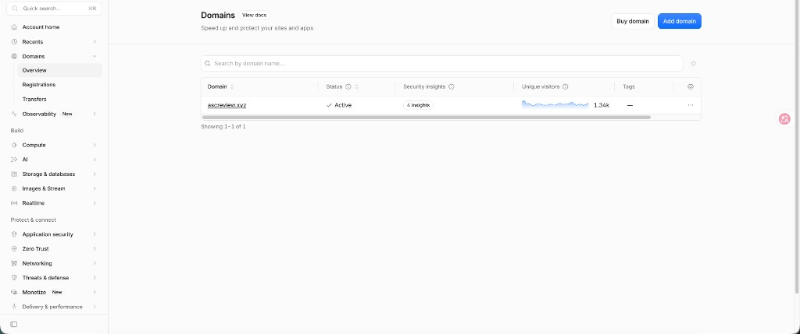

**操作**：点 **Add domain**。

---

### 3.2 选择接入方式：Connect a domain

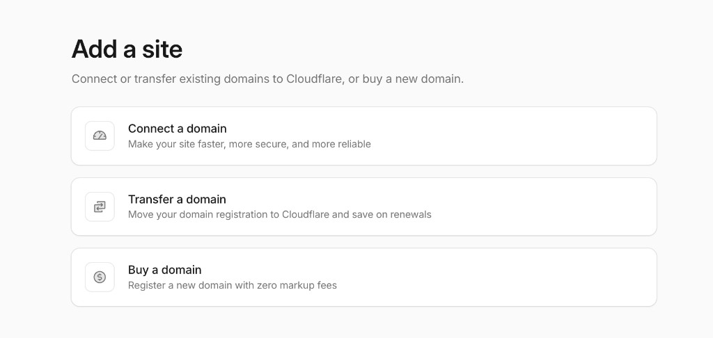

| 选项 | 何时选 |
|------|--------|
| **Connect a domain** | ✅ 域名还在 Spaceship，只把 DNS 接到 CF |
| Transfer a domain | 把注册商迁到 Cloudflare（本次不需要） |
| Buy a domain | 在 CF 新购（域名已在 Spaceship 买过） |

**操作**：选第一个 **Connect a domain**。

---

### 3.3 填写域名与爬虫策略

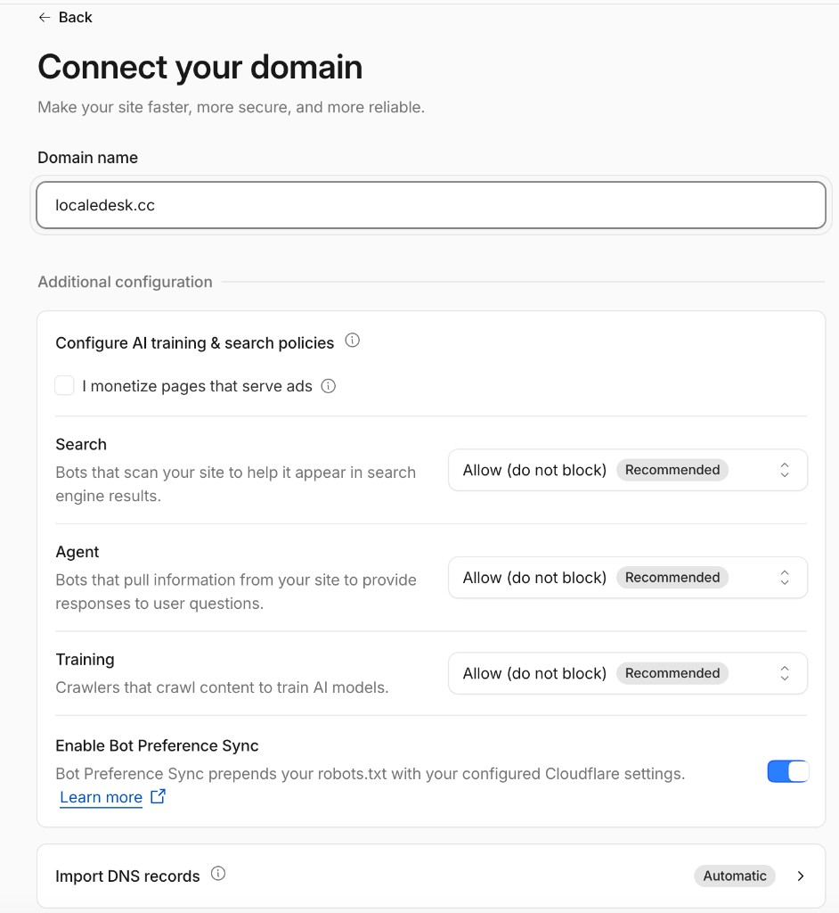

建议：

1. Domain name：`localedesk.cc`（不要 `https://`，不要 `www`）  
2. Search / Agent / Training：**Allow（Recommended）** 保持即可  
3. 「I monetize pages…」：**不要勾**  
4. Import DNS：**Automatic** 可以  
5. Continue

---

### 3.4 选套餐：Free 即可

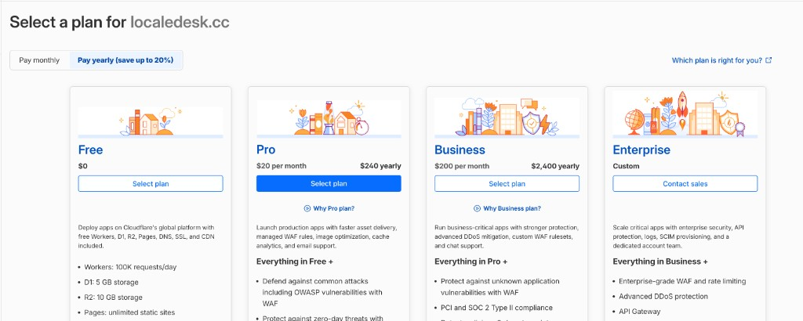

静态官网选左边 **Free → Select plan**。Workers / DNS / SSL / CDN 对落地页足够，不必上 Pro。

---

### 3.5 清理扫进来的停车页 A 记录

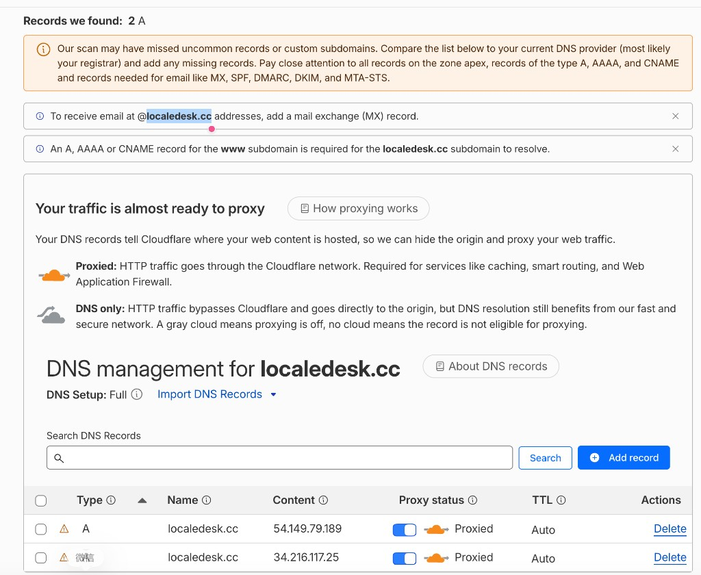

Cloudflare 会从原 DNS 扫记录。图中两条 **A**（含 `localedesk.cc` → AWS IP、以及「微信」相关）是 **Spaceship 停车页/旧配置**，不是 LocaleDesk 官网。

**建议**：

1. 把这两条 A **Delete**  
2. 邮箱 MX 提示：暂时不需要 `@localedesk.cc` 收信可忽略  
3. `www` 记录：后面绑 Worker 时会自动加，可先不手建  
4. 继续拿到 **Nameservers** 步骤

---

### 3.6 Cloudflare 给出的 Nameserver（关键）

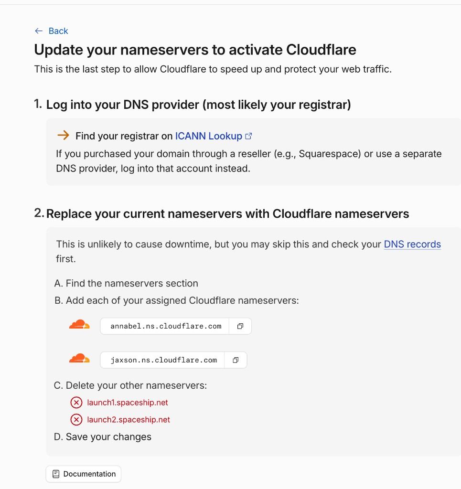

本次分配（以你账号为准；别人域名会不同）：

| 操作 | Nameserver |
|------|------------|
| **添加** | `annabel.ns.cloudflare.com` |
| **添加** | `jaxson.ns.cloudflare.com` |
| **删除（Spaceship 默认）** | `launch1.spaceship.net` |
| **删除** | `launch2.spaceship.net` |

先复制保存，再去 Spaceship。

---

### 3.7 Spaceship：改前（仍是 Spaceship NS）

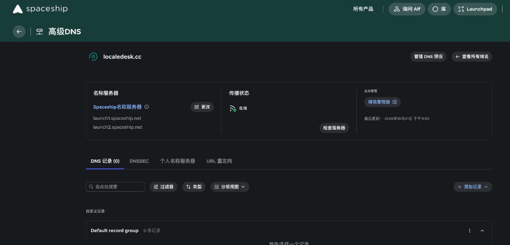

此时：

- 名称服务器 = Spaceship（`launch1/2.spaceship.net`）  
- DNS 记录可以在 Spaceship 管（图中当时为 0 条）

**操作**：点「名称服务器」旁的 **更改** → 自定义名称服务器。

---

### 3.8 Spaceship：改后（已是 Cloudflare NS）

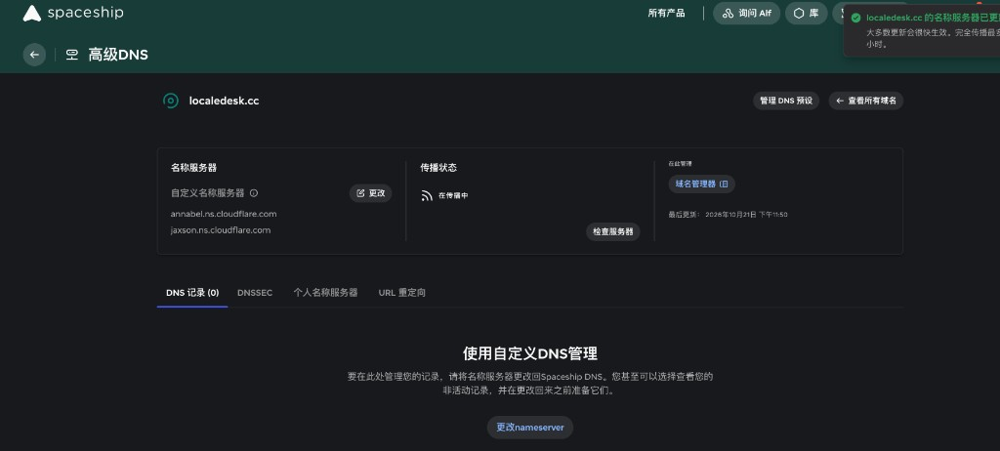

改对的标志：

- 类型：**自定义名称服务器**  
- NS：`annabel` / `jaxson`  
- 传播状态可能显示「在传播中」——正常  
- Spaceship 的 DNS 记录页会提示：用了自定义 NS 后，**请到 Cloudflare 管理 DNS**

---

### 3.9 Cloudflare：确认已更新 NS

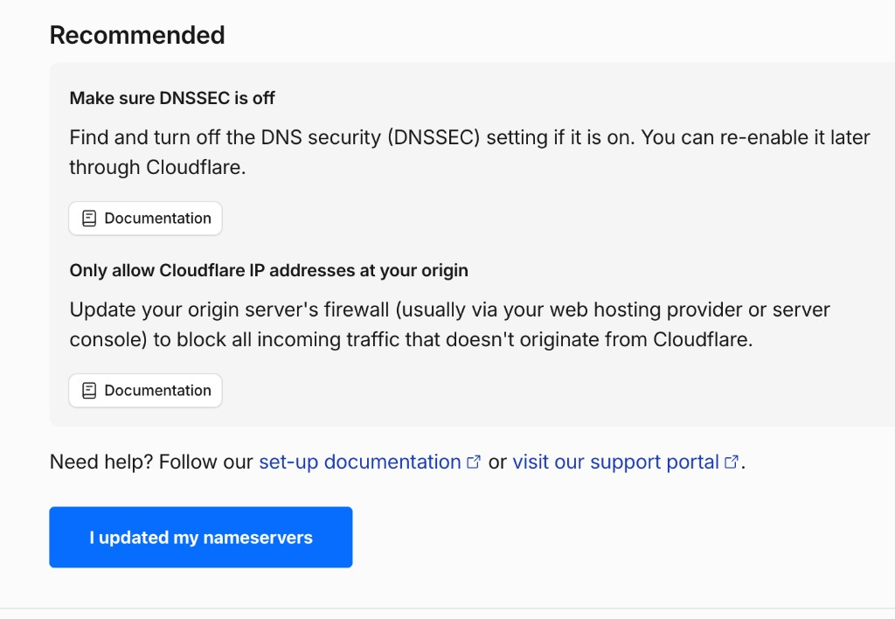

- **Make sure DNSSEC is off**：Spaceship 若开过 DNSSEC 先关；没开可忽略  
- **Only allow Cloudflare IP at origin**：有自建源站才需要；**Workers 静态站不适用**  
- 点蓝色：**I updated my nameservers**

---

### 3.10 Pending：等待 NS 生效

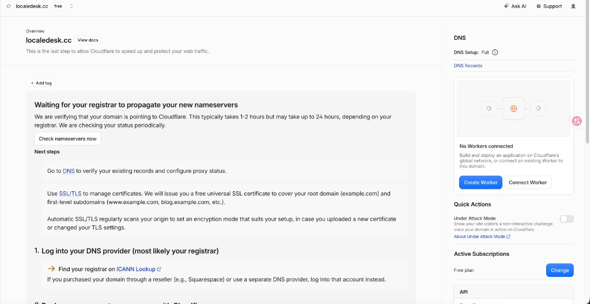

- 状态：Waiting / Pending —— **正常**  
- 可点 **Check nameservers now**；若仍 Pending，多数 **1～2 小时**（偶尔更久）  
- 右侧 **No Workers connected**：此时也正常，等 Active 再部署  
- 提示 *Please wait a few hours*：不必反复狂点

---

### 3.11 Active：Zone 就绪

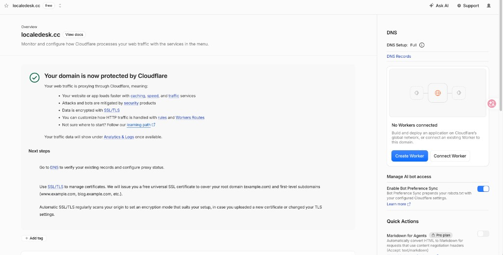

- 绿色勾：**域名已受 Cloudflare 保护** → Zone **Active**  
- 此时即可部署 Worker 自定义域  
- Overview 仍可能短暂显示 No Workers；部署并刷新后会连上

---

## 4. Worker 自定义域绑定

### 4.1 `wrangler.toml` 配置要点

路径：`website/wrangler.toml`

```toml
name = "languagetool-site"
account_id = "98efc023de48d4893f16c4c419008ecd"
workers_dev = true

[assets]
directory = "./public"
not_found_handling = "404-page"
html_handling = "auto-trailing-slash"

[[routes]]
pattern = "localedesk.cc"
custom_domain = true

[[routes]]
pattern = "www.localedesk.cc"
custom_domain = true
```

要点：

- `custom_domain = true` 要求域名 Zone 已在**同一 Cloudflare 账号**且多为 **Active**  
- Zone 未就绪时部署会报类似 *Can't infer zone* / 无法绑定  
- `account_id` 必须与登录账号一致（本机曾出现多账号，需确认）

### 4.2 部署命令

```bash
cd website
npm run deploy
# 或 npx wrangler deploy
```

### 4.3 结果

| URL | 说明 |
|-----|------|
| https://localedesk.cc | 主站（LocaleDesk） |
| https://www.localedesk.cc | www；证书有时晚几分钟签发 |
| https://languagetool-site.findo.workers.dev | workers.dev 备用 |

**失败再成功的常见原因**：先改了文案并部署到 workers.dev，但 Zone 未 Active → 自定义域失败；Active 后再次 deploy 即绑定成功。

### 4.4 Wrangler 登录备忘

若本机未登录：`npx wrangler login`（浏览器授权）。  
未登录时可能走临时 deploy/claim；正式项目应登录并固定 `account_id`。

---

## 5. 技术 SEO 与 Google Search Console

### 5.1 SEO 范围（已实现）

优先级：**English / Google**。技术基础，不做博客、不做 `/en` `/zh` 路径拆分。

交付物：

- `robots.txt`（含 Sitemap 指针）
- `sitemap.xml`（`/`、`/docs/`、`/privacy/`）
- 每页：canonical、Open Graph、Twitter Card
- 首页 JSON-LD：`SoftwareApplication`
- 英文 meta description 加强

详见：`docs/superpowers/specs/2026-10-22-localedesk-technical-seo-design.md`

### 5.2 GSC：添加网域资源

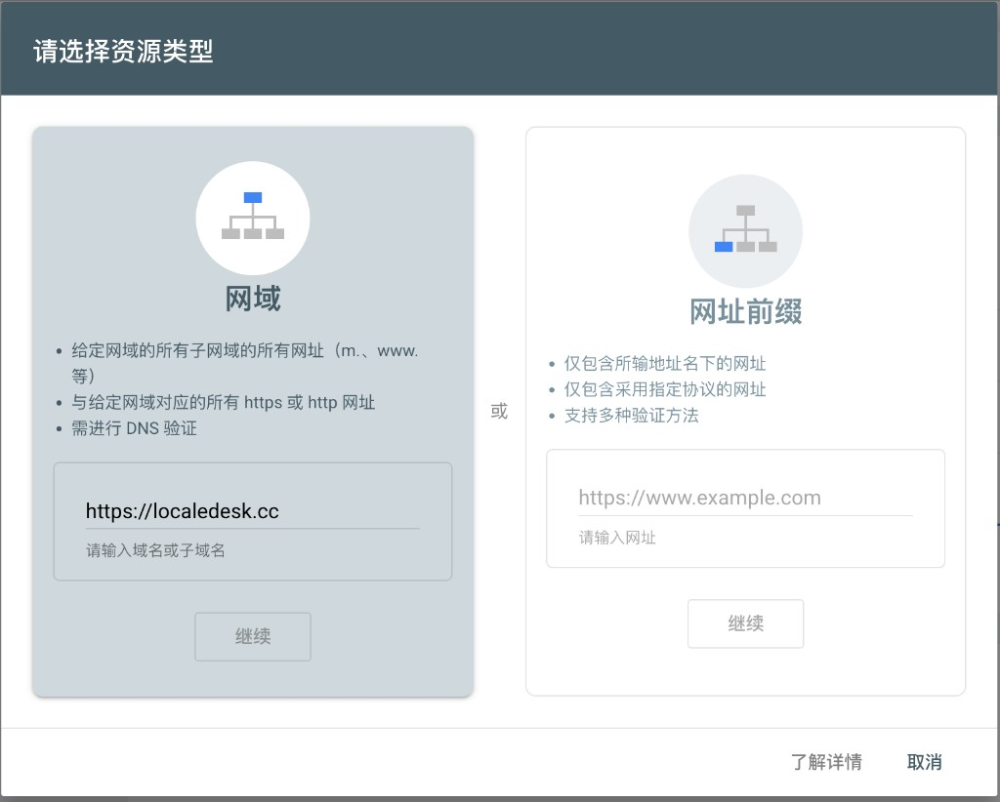

- 推荐选左侧 **网域（Domain）**（覆盖 www / 非 www / http / https）  
- **网域栏只填**：`localedesk.cc`  
- **不要**填 `https://localedesk.cc`（带协议会导致无法继续）

### 5.3 DNS 验证（Cloudflare 一键）

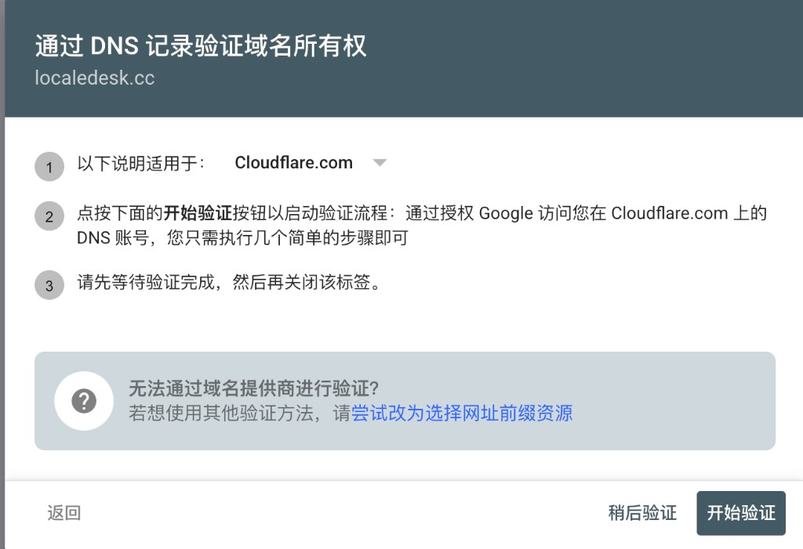

DNS 已在 Cloudflare 时，GSC 可走 **开始验证**（授权 Google 访问 CF DNS），比手写 TXT 省事。  
也可用手动 TXT：在 CF DNS 加 Google 给出的记录后点验证。

### 5.4 验证成功 → 提交站点地图

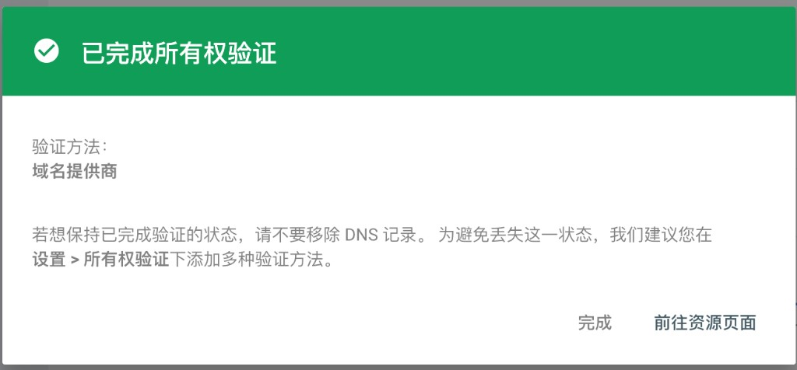

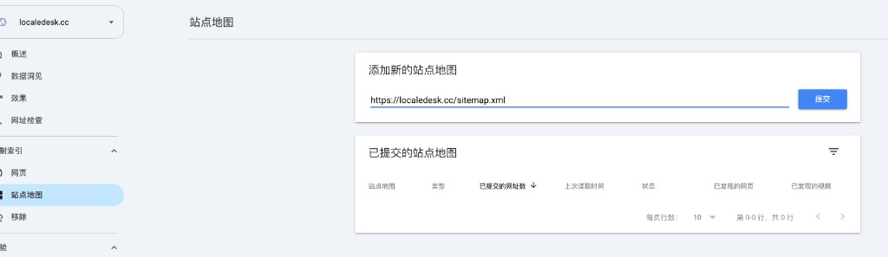

提交：`https://localedesk.cc/sitemap.xml`（或按界面要求填路径）。

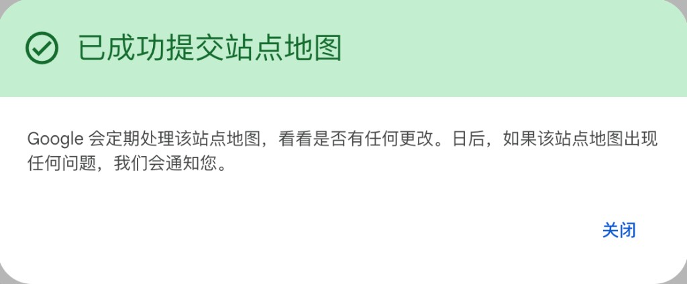

### 5.5 「无法抓取」排查（实战）

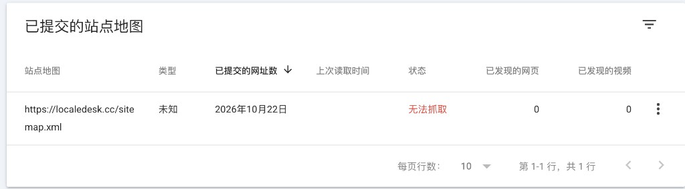

当时现象：

- 状态红字 **无法抓取**  
- **上次读取时间** 为空  
- 已发现网页 = 0  

本地/curl 侧：`sitemap.xml` 已是 **200**、`application/xml`、XML 合法；Googlebot UA 也能拿到。

结论与处理：

1. 提交当下常见占位状态——Google 还没真正来读  
2. 用 **网址检查 → 测试实际网址** 验证可达性  
3. 不必反复重新提交；等 24～48 小时再看列表  
4. 同时确认 CF 未开 Under Attack、Bot Fight 未误伤 Googlebot  

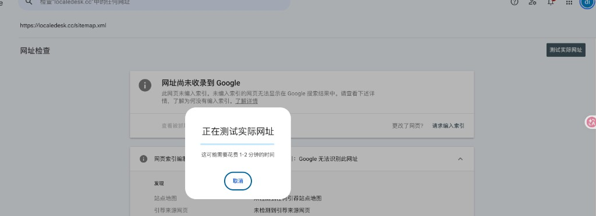

说明：索引页上「网址尚未收录 / Google 无法识别」对 **sitemap.xml 本身** 往往正常——站点地图一般不会当网页收录；也不必对 sitemap 点「请求编入索引」。应检查 Live test 的抓取是否成功。

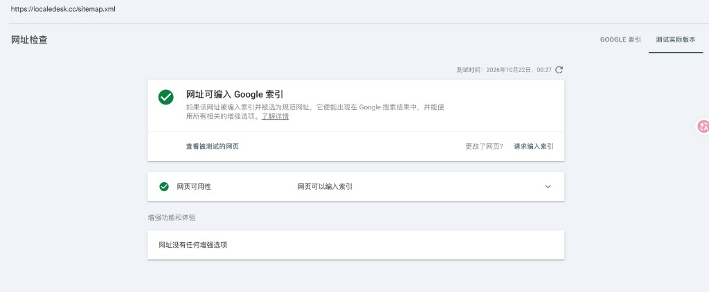

Live test 通过 → 文件与 Cloudflare 侧没问题；站点地图列表状态会随后更新。  
可选：对首页 `https://localedesk.cc/` 请求编入索引（不要对 sitemap 编索引）。

---

## 6. 速查表

### 账号与域名

| 项 | 值 |
|----|-----|
| 品牌 / 展示名 | LocaleDesk |
| 域名 | `localedesk.cc`（Spaceship 购买） |
| Cloudflare 账号（示例） | 与 `account_id` 对应的账号 |
| CF account_id | `98efc023de48d4893f16c4c419008ecd` |
| Worker 名 | `languagetool-site` |
| CF Nameserver | `annabel.ns.cloudflare.com` / `jaxson.ns.cloudflare.com` |
| 原 Spaceship NS | `launch1.spaceship.net` / `launch2.spaceship.net` |
| 套餐 | Free |
| workers.dev | `https://languagetool-site.findo.workers.dev` |
| 生产站 | `https://localedesk.cc` |

### 易错点

| 坑 | 正确做法 |
|----|----------|
| 只在 Spaceship 加 A/CNAME，不改 NS | Workers 自定义域需要 CF Zone；应改 **Nameserver** |
| 选 Transfer / Buy 而不是 Connect | 别家已买 → **Connect a domain** |
| Zone Pending 就绑自定义域 | 等 **Active** 再 deploy |
| 保留停车页 A 记录 | 删掉扫进来的旧 A，交给 Worker 自定义域 |
| GSC 网域填 `https://…` | 只填 `localedesk.cc` |
| 对 sitemap 点「请求编入索引」 | 编首页；sitemap 用「站点地图」提交 |
| 提交后立刻「无法抓取」且无上次读取 | 先 Live test；通过则等待，勿狂点重提 |

### 相关仓库路径

```text
website/
  public/          # 静态站点
  wrangler.toml    # Worker + custom_domain
docs/superpowers/specs/2026-10-12-marketing-website-design.md
docs/superpowers/specs/2026-10-22-localedesk-technical-seo-design.md
docs/localedesk-site-setup/   # 本学习笔记 + images/
```

---

## 7. 截图索引

| 文件 | 阶段 | 画面要点 |
|------|------|----------|
| `image-16e11663-…` | CF 接入 | Domains 列表 → Add domain |
| `image-f3dec190-…` | CF 接入 | Connect / Transfer / Buy |
| `image-ef844d12-…` | CF 接入 | 填写 localedesk.cc + bot 策略 |
| `image-e486854c-…` | CF 接入 | 选 Free |
| `image-ff296a65-…` | CF 接入 | DNS：删除停车页 A |
| `image-e5b007c5-…` | CF 接入 | 更新 Nameserver（annabel/jaxson） |
| `image-001b9024-…` | Spaceship | 改 NS 前（launch1/2） |
| `image-ac3fe75c-…` | Spaceship | 改 NS 后（CF 自定义 NS） |
| `image-c87b6b8e-…` | CF 接入 | I updated my nameservers |
| `image-8c0dc630-…` | CF 接入 | Pending / 等待传播 |
| `image-ac3d816c-…` | CF 接入 | Active / 受保护 |
| `image-8b05b5a5-…` | GSC | 选网域资源（勿带 https） |
| `image-7ec9b8d9-…` | GSC | DNS 验证（Cloudflare） |
| `image-05fac78c-…` | GSC | 所有权已验证 |
| `image-d03d434c-…` | GSC | 站点地图入口 |
| `image-97422851-…` | GSC | 已提交列表 |
| `image-e1cf0789-…` | GSC | 无法抓取（空上次读取） |
| `image-41b4eb6f-…` | GSC | Live test 进行中 |
| `image-8bc9dd46-…` | GSC | Live test 成功 |
| `image-8d068a27-…` | 站点验收 | 早期官网截图反馈（对话中） |
| `image-84c2c448-…` | 站点验收 | 早期官网截图反馈（对话中） |

所有文件位于：[`docs/localedesk-site-setup/images/`](./images/)。

---

## 附录 A：早期站点验收截图

部署到 workers.dev 后的界面反馈截图（字体/布局等迭代用）：

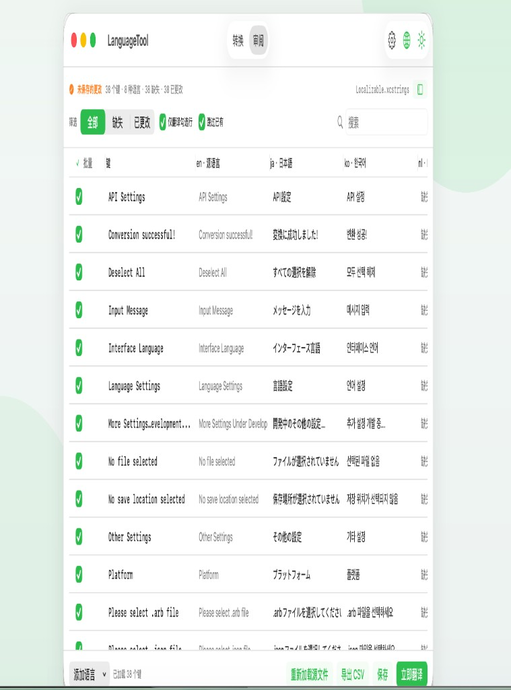

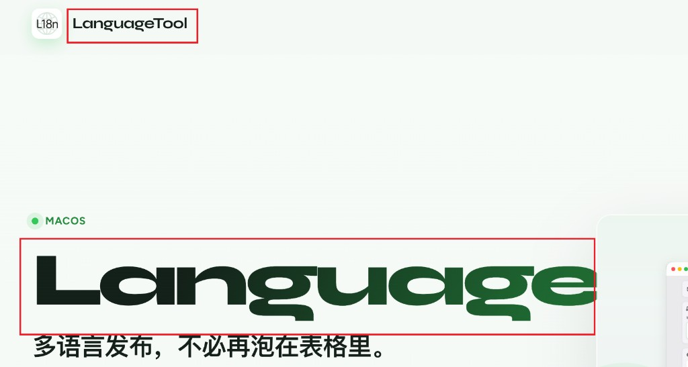

---

## 附录 B：对话时间线（精简）

1. 定官网方向（Workers 静态站、中英、App Store CTA）→ 实现并部署 workers.dev  
2. 讨论 CF 买域名、品牌改名、拒绝弱后缀 → 买下 **LocaleDesk.cc**  
3. 品牌文案改 LocaleDesk；Zone 未就绪导致自定义域失败  
4. Spaceship NS → Cloudflare（上表逐步截图）→ Active  
5. 再次 deploy → `https://localedesk.cc` OK  
6. 技术 SEO 上线 → GSC 网域验证 → 提交 sitemap → Live test 确认可抓取  

完整原始对话见 Cursor agent transcript：  
`agent-transcripts/aee732d0-71b4-4c0c-b81d-ca9f1b9888df/`。
